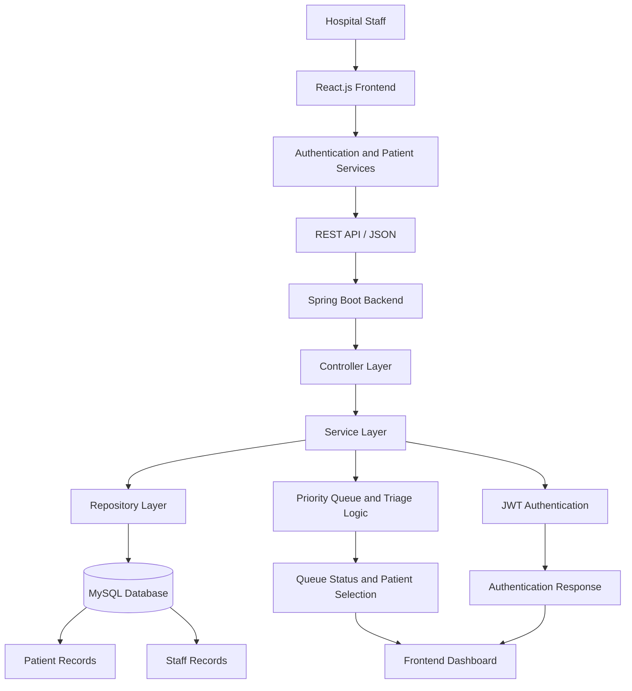
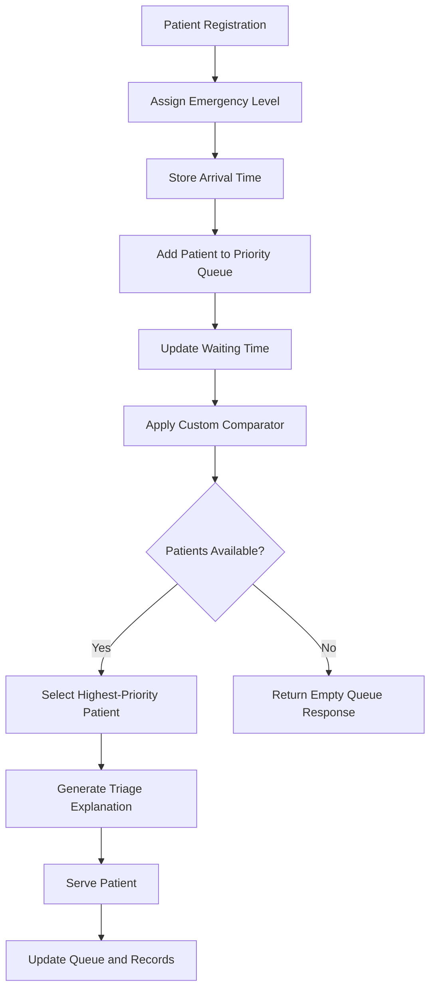

# 🏥 Hospital Queue Management System

A full-stack Hospital Queue Management System built using **Java, Spring Boot, React.js, and MySQL** that intelligently manages patient flow through a priority-based triage mechanism.

Unlike traditional FIFO (First-In-First-Out) queue systems, this application prioritizes patients based on their emergency severity and waiting duration, ensuring that critical patients receive timely attention while maintaining fairness for other patients.

The system provides hospital staff with an interactive dashboard to register patients, monitor queue status, understand triage decisions, and serve individual or multiple patients efficiently.

---

## 📌 Table of Contents

- [Project Overview](#-project-overview)
- [Problem Statement](#-problem-statement)
- [Solution Approach](#-solution-approach)
- [Key Features](#-key-features)
- [Technology Stack](#-technology-stack)
- [System Architecture](#-system-architecture)
- [Project Workflow](#-project-workflow)
- [Project Structure](#-project-structure)
- [Application Modules](#-application-modules)
- [Priority Queue and Triage Algorithm](#-priority-queue-and-triage-algorithm)
- [API Endpoints](#-api-endpoints)
- [Prerequisites](#-prerequisites)
- [Installation and Setup](#️-installation-and-setup)
- [Running the Application](#-running-the-application)
- [Future Enhancements](#-future-enhancements)
- [Learning Outcomes](#-learning-outcomes)
- [Author](#-author)

---

## 🔍 Project Overview

The Hospital Queue Management System is designed to simplify patient queue handling in hospitals by replacing traditional manual queue management with an intelligent, automated scheduling mechanism.

The application consists of two major components:

**1. Backend (Spring Boot)**

Responsible for authentication, patient registration, queue management, triage calculations, business logic, database operations, and scheduled waiting-time updates.

**2. Frontend (React.js)**

Provides a user-friendly interface for hospital staff to authenticate, register patients, monitor queue statistics, view patient information, and manage patient serving operations.

The backend communicates with the frontend through RESTful APIs using JSON.

---

## ❗ Problem Statement

Traditional hospital queue systems generally follow FIFO scheduling, where patients are served according to their arrival time.

However, this approach creates several challenges:

- Critical patients may have to wait behind less severe cases.
- Emergency situations require immediate prioritization.
- Long-waiting patients may experience unnecessary delays.
- Manual queue management can lead to operational errors.
- Staff may lack transparency regarding patient serving order.

**The objective is to develop an intelligent queue management solution that considers both medical urgency and waiting duration.**

---

## 💡 Solution Approach

This project implements a priority-based scheduling mechanism using Java's `PriorityQueue` and a custom comparator.

The system considers:

1. **Emergency Severity:** Patients with higher medical urgency receive higher priority.
2. **Waiting Duration:** Waiting time is periodically updated to support fairness.
3. **Arrival Time:** Used as a tie-breaker when other priority conditions are equal.
4. **Triage Explanation:** Provides information about why a particular patient is selected next.

The system also uses a scheduled process to update waiting times automatically and provides queue-management operations through REST APIs.

---

## ✨ Key Features

### 🔐 Authentication and Staff Management
- Staff registration.
- Staff login.
- Password authentication.
- JWT-based authentication.
- Authentication session management on the frontend.
- Protected application routes.

### 🧑‍⚕️ Patient Management
- Register new patients.
- Store patient information.
- Assign emergency severity.
- Maintain patient records.

### 🚑 Intelligent Queue Management
- Priority-based patient scheduling.
- Emergency-aware patient selection.
- Dynamic waiting-time updates.
- Serve the next patient.
- Serve multiple patients in one operation.

### 📊 Dashboard and Monitoring
- Interactive staff dashboard.
- Patient queue status.
- Queue statistics.
- Patient-serving information.
- Triage explanations.

### ⚙️ Backend Features
- Layered application architecture.
- RESTful API integration.
- Spring Data JPA and Hibernate.
- MySQL persistence.
- Centralized exception handling.
- Scheduled waiting-time updates.

---

## 🛠️ Technology Stack

| Category | Technologies |
|---|---|
| Programming Language | Java |
| Backend Framework | Spring Boot |
| Backend APIs | Spring Web |
| ORM | Hibernate |
| Data Access | Spring Data JPA |
| Database | MySQL |
| Authentication | Spring Security / JWT |
| Frontend Library | React.js |
| Frontend Language | JavaScript (ES6+) |
| Styling | CSS3 |
| Frontend Build Tool | Vite |
| Backend Build Tool | Maven |
| API Communication | REST APIs / JSON |
| Data Structures | PriorityQueue, Custom Comparator |
| API Testing | Postman |
| Version Control | Git and GitHub |
| IDE | VS Code / IntelliJ IDEA / Eclipse |

---

## 🏗️ System Architecture

The application follows a layered full-stack architecture.



### Architecture Responsibilities

| Layer | Responsibility |
|---|---|
| React Frontend | User interface and staff interactions |
| Service Clients | Communicate with backend APIs |
| Controller Layer | Handle incoming HTTP requests |
| Service Layer | Implement business logic and queue operations |
| Repository Layer | Perform database operations |
| Entity Layer | Represent persistent database records |
| Model Layer | Handle requests, responses, and application data |
| Authentication Layer | Validate staff credentials and JWT |
| Scheduler | Update waiting-time information periodically |
| MySQL | Persist patient and staff information |

---

## 🔄 Project Workflow

The following workflow describes how the complete application operates, from staff authentication to patient serving.

### 1. Staff Authentication

- Hospital staff opens the React application.
- Staff registers or logs into the system.
- The frontend sends authentication requests to the backend.
- The authentication service validates the credentials.
- JWT is generated and returned after successful authentication.
- The frontend maintains the authenticated session and provides access to protected routes.

### 2. Patient Registration

- Staff navigates to the patient registration page.
- Patient details and emergency information are entered.
- The frontend sends patient information to the backend.
- The controller receives the request.
- The service layer processes the information.
- Patient records are saved through the repository into MySQL.

### 3. Queue Management and Triage

- Registered patients are managed through the queue service.
- A Java `PriorityQueue` organizes patients according to the configured priority comparator.
- Emergency severity determines medical urgency.
- Waiting duration is periodically updated.
- Arrival time helps resolve priority ties.

### 4. Queue Status Monitoring

- Staff accesses the dashboard.
- The frontend requests the latest queue information.
- The backend processes the request and prepares the queue status.
- The response is returned in JSON format.
- The dashboard displays the current queue information.

### 5. Patient Serving

- Staff requests the next patient or selects the multiple-patient serving operation.
- The queue service identifies patients according to the priority rules.
- Selected patients are processed and their records are updated.
- The frontend receives the response and refreshes the dashboard.

### 6. Triage Explanation

The system provides a triage explanation to help staff understand why a particular patient is selected next.

This improves transparency and makes the queue-selection process easier to understand.

---

## 📂 Project Structure

The repository is organized into separate backend and frontend applications.

### Backend Structure

```text
backend/
│
├── .mvn/
├── .settings/
│
├── src/
│   ├── main/
│   │   ├── java/
│   │   │   └── com/hospital/management/
│   │   │       │
│   │   │       ├── auth/
│   │   │       │   ├── AuthService.java
│   │   │       │   └── JwtUtil.java
│   │   │       │
│   │   │       ├── config/
│   │   │       │
│   │   │       ├── controller/
│   │   │       │
│   │   │       ├── entity/
│   │   │       │   ├── PatientEntity.java
│   │   │       │   └── StaffEntity.java
│   │   │       │
│   │   │       ├── exception/
│   │   │       │   ├── GlobalExceptionHandler.java
│   │   │       │   └── QueueEmptyException.java
│   │   │       │
│   │   │       ├── model/
│   │   │       │   ├── AuthResponse.java
│   │   │       │   ├── LoginRequest.java
│   │   │       │   ├── Patient.java
│   │   │       │   ├── PatientRequest.java
│   │   │       │   ├── QueueStatusResponse.java
│   │   │       │   ├── RegisterRequest.java
│   │   │       │   ├── ServeMultipleRequest.java
│   │   │       │   └── TriageResponse.java
│   │   │       │
│   │   │       ├── repository/
│   │   │       │   ├── PatientRepository.java
│   │   │       │   └── StaffRepository.java
│   │   │       │
│   │   │       ├── scheduler/
│   │   │       │   └── WaitingTimeScheduler.java
│   │   │       │
│   │   │       ├── service/
│   │   │       │   └── QueueService.java
│   │   │       │
│   │   │       └── HospitalQueueSystemApplication.java
│   │   │
│   │   └── resources/
│   │       ├── static/
│   │       ├── templates/
│   │       └── application.properties
│   │
│   └── test/
│
├── target/
├── .gitignore
├── mvnw
├── mvnw.cmd
└── pom.xml
```

### Frontend Structure

```text
frontend/
│
├── public/
│
├── src/
│   │
│   ├── components/
│   │   ├── Loader.jsx
│   │   ├── Navbar.jsx
│   │   ├── ProtectedRoute.jsx
│   │   ├── Sidebar.jsx
│   │   └── StatCard.jsx
│   │
│   ├── context/
│   │   └── AuthContext.jsx
│   │
│   ├── pages/
│   │   ├── Dashboard.jsx
│   │   ├── Landing.jsx
│   │   ├── Login.jsx
│   │   ├── Register.jsx
│   │   ├── RegisterPatient.jsx
│   │   └── ServeMultiple.jsx
│   │
│   ├── services/
│   │   ├── api.js
│   │   ├── authService.js
│   │   └── patientService.js
│   │
│   ├── styles/
│   │   ├── auth.css
│   │   ├── dashboard.css
│   │   ├── forms.css
│   │   ├── global.css
│   │   ├── Landing.css
│   │   ├── loader.css
│   │   ├── navbar.css
│   │   └── sidebar.css
│   │
│   ├── App.css
│   ├── App.jsx
│   ├── index.css
│   └── main.jsx
│
├── Project_Overview_Diagram.png
├── index.html
├── package.json
├── package-lock.json
└── vite.config.js
```

---

## 🧩 Application Modules

### Backend Modules

| Module | Responsibility |
|---|---|
| Auth | Staff authentication and JWT generation |
| Config | Application and security configuration |
| Controller | REST API request handling |
| Entity | Patient and staff database entities |
| Exception | Centralized error handling |
| Model | Request, response, and domain models |
| Repository | Database access using Spring Data JPA |
| Scheduler | Automatic waiting-time updates |
| Service | Patient queue and triage business logic |

### Frontend Modules

| Module | Responsibility |
|---|---|
| Components | Reusable UI components |
| Context | Authentication state management |
| Pages | Login, registration, dashboard, and queue operations |
| Services | Backend API communication |
| Styles | Page-specific and global styling |
| ProtectedRoute | Restrict access to authenticated users |

---

## 🧠 Priority Queue and Triage Algorithm

One of the most important technical aspects of this project is the implementation of a priority-based patient scheduling mechanism.

Instead of relying on a normal FIFO queue, the application uses Java's `PriorityQueue`.

### Why PriorityQueue?

A normal queue serves patients according to arrival order.

However, in a hospital environment, a critical patient should receive attention before a less severe patient, even if the critical patient arrives later.

A priority queue allows the system to select patients based on their calculated priority.

### Priority Factors

The comparator considers:

1. Emergency severity.
2. Waiting duration.
3. Arrival time as a tie-breaker.

### Algorithm Workflow



### Time Complexity

For Java's heap-based `PriorityQueue`:

| Operation | Time Complexity |
|---|---|
| Insert patient | O(log n) |
| Peek highest-priority patient | O(1) |
| Remove highest-priority patient | O(log n) |
| Build heap from n patients | O(n) |

*Note: The complexity of updating priorities for multiple patients also depends on the implementation and whether the queue is rebuilt or individual entries are reinserted.*

---

## 🔌 API Endpoints

The application exposes REST APIs for authentication and patient queue operations.

### Authentication APIs

| HTTP Method | Endpoint | Description |
|---|---|---|
| POST | `/auth/register` | Register hospital staff |
| POST | `/auth/login` | Authenticate staff |

### Patient APIs

| HTTP Method | Endpoint | Description |
|---|---|---|
| POST | `/patients/register` | Register a new patient |
| GET | `/patients/status` | Retrieve queue status |
| GET | `/patients/next` | Get the next patient |
| POST | `/patients/serve` | Serve the next patient |
| POST | `/patients/serve-multiple` | Serve multiple patients |
| GET | `/patients/next-explanation` | Retrieve next-patient triage explanation |

**Note:** These are the documented application routes. Confirm the final mappings against the controller annotations and API configuration when making changes to the backend.

---

## 💻 Prerequisites

Before running the application, make sure the following software is installed:

| Software | Purpose |
|---|---|
| Java JDK | Run Spring Boot application |
| Apache Maven | Backend dependency management |
| Node.js (LTS) | Run React application |
| npm | Frontend dependency management |
| MySQL Server | Database management |
| MySQL Workbench | Database visualization (optional) |
| VS Code / IntelliJ IDEA | Development environment |
| Postman | REST API testing (optional) |
| Git | Version control |

Use the Java version specified in `backend/pom.xml`.

---

## ⚙️ Installation and Setup

Follow these steps to run the project on your local machine.

### Step 1: Clone the Repository

```bash
git clone https://github.com/Aman83Verma/Hospital_Queue_Management_System.git
```

Navigate to the project directory:

```bash
cd Hospital_Queue_Management_System
```

### Step 2: Configure MySQL Database

Open MySQL Workbench or your preferred MySQL client.

Create the database:

```sql
CREATE DATABASE hospital_queue_db;
```

Open the backend configuration file:

```text
backend/src/main/resources/application.properties
```

Configure your MySQL connection:

```properties
spring.datasource.url=jdbc:mysql://localhost:3306/hospital_queue_db
spring.datasource.username=root
spring.datasource.password=YOUR_MYSQL_PASSWORD

spring.jpa.hibernate.ddl-auto=update
spring.jpa.show-sql=true
spring.jpa.properties.hibernate.format_sql=true
```

Make sure the database name, username, password, and other database settings match your local MySQL configuration.

**Security Note:** Never commit real database passwords, JWT secrets, or other sensitive credentials to GitHub.

### Step 3: Run the Backend

Open a terminal and navigate to the backend directory:

```bash
cd backend
```

Build the application using Maven:

```bash
mvn clean install
```

Alternatively, use the included Maven Wrapper on Windows:

```bash
.\mvnw.cmd clean install
```

Run the Spring Boot application:

```bash
mvn spring-boot:run
```

Or use the Maven Wrapper:

```bash
.\mvnw.cmd spring-boot:run
```

The backend will start at:

```text
http://localhost:8080
```

### Step 4: Install Frontend Dependencies

Open another terminal and navigate to the frontend directory:

```bash
cd frontend
```

Install the required npm packages:

```bash
npm install
```

This command automatically installs the dependencies defined in `package.json`.

### Step 5: Start the Frontend

Run the Vite development server:

```bash
npm run dev
```

The frontend will be available at:

```text
http://localhost:5173
```

### Step 6: Access the Application

Open your browser and visit:

```text
http://localhost:5173
```

Register a staff account or log in to access the application dashboard.

---

## 📦 Required Dependencies and Modules

The project uses Maven for backend dependency management and npm for frontend dependency management.

### Backend Dependencies

The following technology modules are used in the backend:

- Spring Boot Starter Web – REST API development.
- Spring Boot Starter Data JPA – Database operations.
- MySQL Connector/J – MySQL connectivity.
- Hibernate ORM – Object-relational mapping.
- Spring Security – Application security and authentication.
- JWT libraries – Token generation and validation.
- Maven – Build and dependency management.

The exact dependency versions and Maven coordinates are maintained in:

`backend/pom.xml`

### Frontend Dependencies

The frontend uses:

- React – Component-based UI development.
- React DOM – Rendering React components.
- Vite – Frontend development server and build tool.
- JavaScript – Application logic.
- CSS – Styling and responsive layouts.
- Additional packages specified in `package.json`.

Install all frontend modules using:

```bash
npm install
```

**Important:** You do not need to install every library manually. Maven and npm automatically resolve the dependencies declared in their respective configuration files.

---

## 🚀 Future Enhancements

The following features could further improve the application:

- Role-based access control for different hospital staff.
- Multiple doctor and department management.
- Appointment scheduling.
- SMS and email notifications.
- Real-time queue updates using WebSockets.
- Patient history and treatment records.
- Advanced analytics and reporting dashboard.
- Docker-based deployment.
- Cloud deployment using AWS or Azure.
- Automated unit and integration testing.

---

## 🎓 Learning Outcomes

Working on this project provided practical experience in:

- Developing RESTful APIs using Spring Boot.
- Implementing Java Data Structures and Algorithms.
- Applying PriorityQueue to a real-world scheduling problem.
- Designing layered backend architecture.
- Working with Spring Data JPA and Hibernate.
- Integrating MySQL with Spring Boot.
- Implementing JWT-based authentication.
- Building reusable React components.
- Managing frontend authentication using React Context.
- Integrating React with Spring Boot APIs.
- Handling exceptions and application-level errors.
- Implementing scheduled backend tasks.
- Managing a full-stack project using Git and GitHub.

---

## 👨‍💻 Author

**Aman Verma**

Java Full Stack Developer

**Technologies:** Java | Spring Boot | React.js | MySQL | Hibernate | REST APIs | Data Structures & Algorithms

- GitHub: https://github.com/Aman83Verma
- Project Repository: https://github.com/Aman83Verma/Hospital_Queue_Management_System

---

## ⭐ Support

If you find this project useful or interesting, consider giving the repository a star ⭐ on GitHub.

Thank you for visiting the Hospital Queue Management System!

